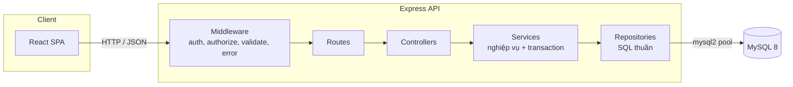

# ARCHITECTURE - Kiến trúc hệ thống

## 1. Tổng quan

| Thành phần           | Công nghệ                                     | Ghi chú                                                 |
| -------------------- | --------------------------------------------- | ------------------------------------------------------- |
| Frontend             | React 18, TypeScript, Vite, React Router, Axios, Recharts | SPA, phân quyền hiển thị theo role                      |
| Backend              | Node.js, Express 4, TypeScript                | REST API, JSON                                          |
| CSDL                 | MySQL 8 (InnoDB)                              | Truy cập qua `mysql2/promise`, **SQL thuần, không ORM** |
| Xác thực             | JWT (access token) + bcrypt                   | Token gửi qua header `Authorization: Bearer`            |
| Kiểm tra dữ liệu vào | Zod                                           | Ở tầng controller/route                                 |
| Triển khai demo      | Docker Compose (mysql, seeder, api, web)              |                                                         |

Kiểu kiến trúc: **Client-Server, n-tier (layered)** với mô hình **Controller - Service - Repository**. Frontend và backend tách biệt, giao tiếp qua REST.



### Trách nhiệm từng tầng

| Tầng           | Trách nhiệm                                                                                                        | Không được làm            |
| -------------- | ------------------------------------------------------------------------------------------------------------------ | ------------------------- |
| **Route**      | Khai báo endpoint, gắn middleware `authenticate`, `authorize`, `validate`                                          | Chứa logic                |
| **Controller** | Đọc `req`, gọi service, trả `res` với đúng HTTP status                                                             | Viết SQL, mở transaction  |
| **Service**    | Quy tắc nghiệp vụ (tính giá, giảm giá hạng, kiểm tra trạng thái, row-level), **mở và commit/rollback transaction** | Viết SQL                  |
| **Repository** | Chứa toàn bộ câu SQL, nhận tham số, trả về dữ liệu thô. Mỗi hàm nhận `conn` tuỳ chọn để chạy trong transaction     | Biết về `req`, `res`, JWT |

Quy tắc bắt buộc: truy vấn nghiệp vụ nằm trong `repository/`, dùng **prepared statement** (`?`) để chống SQL injection. Không nối chuỗi từ dữ liệu người dùng. Với `ORDER BY` động, so khớp với danh sách cột cho phép (whitelist).

---

## 2. Cấu trúc thư mục

```
dbms-application/
├── docker-compose.yml
├── database/
│   ├── schema.sql              # DDL sinh từ ERD
│   ├── indexes.sql             # Index cho demo Indexing (tách riêng để so sánh trước/sau)
│   ├── explain-indexes.sql      # EXPLAIN trước/sau cho B-Tree
│   └── explain-fulltext.sql     # EXPLAIN cho tìm kiếm catalog
├── backend/
│   ├── package.json
│   ├── .env.example
│   └── src/
│       ├── server.ts           # Khởi động HTTP
│       ├── app.ts              # Dựng Express, gắn middleware, routes
│       ├── config/
│       │   ├── env.ts
│       │   └── db.ts           # mysql2 pool, helper withTransaction
│       ├── middlewares/
│       │   ├── authenticate.ts # Xác thực JWT, gắn req.user
│       │   ├── authorize.ts    # authorize('sales','admin')
│       │   ├── validate.ts     # Zod schema
│       │   └── errorHandler.ts # Chuyển AppError, lỗi MySQL sang HTTP
│       ├── routes/
│       │   ├── index.ts
│       │   ├── auth.routes.ts
│       │   ├── catalog.routes.ts
│       │   ├── order.routes.ts
│       │   ├── payment.routes.ts
│       │   ├── review.routes.ts
│       │   ├── sales.routes.ts
│       │   └── admin.routes.ts
│       ├── controllers/        # Mỗi file tương ứng một routes
│       ├── services/
│       │   ├── auth.service.ts
│       │   ├── catalog.service.ts
│       │   ├── order.service.ts      # FR5, FR6, FR9 (transaction)
│       │   ├── payment.service.ts    # FR7
│       │   ├── review.service.ts     # FR10
│       │   ├── sales.service.ts      # FR11-13
│       │   └── admin.service.ts      # FR14-15
│       ├── repository/
│       │   ├── user.repository.ts
│       │   ├── customer.repository.ts
│       │   ├── tier.repository.ts
│       │   ├── catalog.repository.ts     # products, brands, categories, materials
│       │   ├── variant.repository.ts     # product_variants, variant_materials
│       │   ├── inventory.repository.ts   # atomic reservation; optimistic restock
│       │   ├── edition.repository.ts     # edition_units (FOR UPDATE)
│       │   ├── order.repository.ts       # orders, order_items
│       │   ├── payment.repository.ts
│       │   ├── review.repository.ts
│       │   └── report.repository.ts      # truy vấn aggregate
│       ├── scripts/            # Bootstrap, seed và kiểm thử
│       └── utils/
│           ├── AppError.ts
│           └── asyncHandler.ts
└── frontend/
    ├── package.json
    ├── vite.config.ts
    └── src/
        ├── main.tsx
        ├── App.tsx                 # Định nghĩa route
        ├── api/                    # axios instance + hàm gọi từng nhóm API
        ├── auth/                   # AuthContext, ProtectedRoute, useAuth
        ├── layouts/                # PublicLayout, CustomerLayout, SalesLayout, AdminLayout
        ├── pages/
        │   ├── public/             # P01-P05
        │   ├── customer/           # C01-C08
        │   ├── sales/              # S01-S07
        │   └── admin/              # A01-A10
        ├── components/             # ProductCard, DataTable, StatusBadge, ...
        └── utils/                  # formatVND, formatDate
```

---

## 3. Tầng Repository (SQL thuần)

### 3.1 Kết nối và helper transaction

`backend/src/config/db.ts` tạo pool MySQL và cung cấp `withTransaction`. Helper lấy connection, thiết lập isolation level, mở transaction, commit khi thành công hoặc rollback khi có lỗi và trả connection về pool. Mặc định là `REPEATABLE READ`.

### 3.2 Quy ước viết repository

- Các thao tác cần dùng trong transaction nhận connection từ service.
- Câu lệnh ghi kiểm tra `affectedRows` khi cần phát hiện xung đột.
- Từ khóa catalog dùng `MATCH` trên ba cột được lập chỉ mục trong `indexes.sql`. Từ khóa chỉ có token ngắn dùng `LIKE` literal.

### 3.3 Danh mục repository và FR phụ trách

| File                      | Bảng chính                              | FR                  | Loại query tiêu biểu |
| ------------------------- | --------------------------------------- | ------------------- | -------------------- |
| `user.repository.ts`      | users                                   | FR0, FR1, A09            | a, d                 |
| `customer.repository.ts`  | customers                               | FR1, FR15           | a, c, g              |
| `tier.repository.ts`      | membership_tiers                        | FR15b               | a, c, g              |
| `catalog.repository.ts`   | products, brands, categories, materials | FR2, FR3, FR14      | d, e, f              |
| `variant.repository.ts`   | product_variants, variant_materials     | FR4, FR14           | f, a, c, b, g        |
| `inventory.repository.ts` | inventory                               | FR5, FR9, FR12      | c, f, g              |
| `edition.repository.ts`   | edition_units                           | FR6, FR9            | c                    |
| `order.repository.ts`     | orders, order_items                     | FR5, FR8, FR9, FR11 | a, b, c, d, f        |
| `payment.repository.ts`   | payments                                | FR7, FR8, FR13      | a, c, e, f           |
| `review.repository.ts`    | reviews                                 | FR10, A10                | a, b, g              |
| `report.repository.ts`    | (nhiều bảng)                            | FR15a               | f, g, h              |

---

## 4. Tầng Service và giao dịch đặt hàng

`order.service.placeOrder` lấy giá từ biến thể và tỷ lệ giảm từ hạng hiện tại. Service giữ tồn kho bằng atomic conditional UPDATE theo số lượng khả dụng, khóa và đánh dấu reserved ngay serial khả dụng cho Limited Edition rồi ghi đơn, dòng hàng và lịch thanh toán trong một transaction. Thứ tự khóa theo `(variantId, locationId)`. Mỗi dòng Limited nhận serial riêng, kể cả khi cùng variant xuất hiện nhiều lần. Reservation không dùng version predicate hay retry loop; restock vẫn kiểm version.

Khi hủy hoặc bàn giao, câu lệnh đầu tiên chỉ chuyển trạng thái nếu trạng thái đã đọc vẫn khớp. Sau đó mới hoàn/trừ tồn kho, cập nhật serial và ghi nhận tổng chi tiêu trong cùng transaction.

## 5. Xác thực và phân quyền

`POST /api/auth/login` dùng bcrypt và ký JWT. Middleware `authenticate` đối chiếu token với tài khoản còn hoạt động. `authorize` kiểm vai trò. Service và repository áp dụng quy tắc sở hữu đơn, khoản thanh toán và đánh giá. A09 tạo Sales hoặc Admin, khóa hoặc mở khóa Sales và Customer. A10 liệt kê đánh giá và dùng lại luồng xóa FR10.

## 6. Danh sách API

Xem [API_CONTRACT.md](API_CONTRACT.md) cho endpoint, request, response và mã lỗi.

## 7. Giao dịch và đồng thời (Concurrency)

| Tình huống                                  | Cơ chế                                                                       | Vị trí                                 |
| ------------------------------------------- | ---------------------------------------------------------------------------- | -------------------------------------- |
| Hai khách đặt cùng biến thể, tồn kho còn ít | Atomic UPDATE với `qty_on_hand - qty_reserved >= ?`; tăng version như change token | `inventory.repository.reserveStockIfAvailable` |
| Hai khách mua chiếc Limited Edition cuối    | Pessimistic locking `SELECT ... FOR UPDATE`                                  | `edition.repository.lockAvailableUnit` |
| Huỷ đơn đồng thời với Sales xác nhận        | `UPDATE ... WHERE status = ?`, kiểm `affectedRows`                   | `order.repository`                     |
| Hai Sales cùng nhận một đơn                 | `UPDATE ... WHERE sales_user_id IS NULL`                                     | `sales.repository.claimOrderAtomic`          |
| Trả cùng một khoản hai lần                  | `UPDATE ... WHERE status IN ('pending', 'overdue')`                                        | `payment.repository.payPayment`          |

Mức cô lập mặc định `REPEATABLE READ` (InnoDB). Có thể truyền tham số thứ hai của `withTransaction` để demo `READ COMMITTED` và `SERIALIZABLE`.

Lập lịch thu tiền khóa dòng đơn trước khi đọc và kiểm tra tổng các khoản còn hiệu lực.

---

## 8. Kết nối với các topic của đề

| Topic                     | Nơi thể hiện trong hệ thống                                                                                                 |
| ------------------------- | --------------------------------------------------------------------------------------------------------------------------- |
| Data storage & management | `database/schema.sql`, kiểu `JSON` ở `order_items.customization`                                                            |
| Indexing                  | `database/indexes.sql`, chạy `EXPLAIN` cho `catalog.repository` (FR3) và `report.repository` (FR15) trước/sau khi tạo index |
| Query processing          | Cùng truy vấn FR3, FR15 với `EXPLAIN ANALYZE`, so sánh JOIN và subquery                                                     |
| Transaction               | `order.service.placeOrder`, `cancelOrder`                                                                                   |
| Concurrency control       | Mục 7 và `backend/src/scripts/test-sales.ts` kiểm thử HTTP đồng thời                               |
| Backup & recovery         | `mysqldump`, binary log (`mysqlbinlog`), không cần code app                                                                 |

## 9. Cấu hình và triển khai

`docker-compose.yml` dùng MySQL 8.0 và Node 20. Sau khi MySQL healthy, seeder tạo schema, áp dụng index và nạp dữ liệu mẫu cho database mới. Volume có tài khoản được giữ dữ liệu. API đợi seeder hoàn tất và web đợi API healthy. Dùng `backend/.env.example` và [README](../README.md) để chạy trực tiếp.

## 10. Bảo mật và chất lượng

| Hạng mục       | Biện pháp                                                                     |
| -------------- | ----------------------------------------------------------------------------- |
| SQL injection  | Prepared statement (`conn.execute`), whitelist cho `ORDER BY`                 |
| Mật khẩu       | `bcrypt` (cost 10-12), không trả `password_hash` ra API                       |
| XSS            | React tự escape, không dùng `dangerouslySetInnerHTML` cho nội dung người dùng |
| CORS           | Chỉ cho phép origin của frontend                                              |
| Rate limit     | `express-rate-limit` cho `/api/auth/*`                                        |
| Header bảo mật | `helmet`                                                                      |
| Log            | `morgan` (request), log lỗi ở `errorHandler`                                  |
| Kiểm thử       | Smoke test qua service và HTTP trên schema MySQL riêng, chạy bằng GitHub Actions             |
