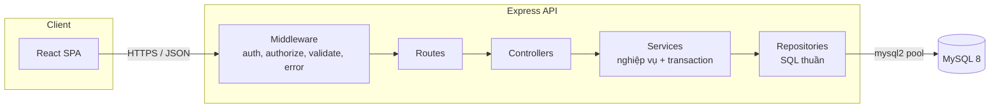

# ARCHITECTURE - Kiến trúc hệ thống

## 1. Tổng quan

| Thành phần           | Công nghệ                                     | Ghi chú                                                 |
| -------------------- | --------------------------------------------- | ------------------------------------------------------- |
| Frontend             | React 18, TypeScript, Vite, React Router, Axios, Recharts | SPA, phân quyền hiển thị theo role                      |
| Backend              | Node.js, Express 4, TypeScript                | REST API, JSON                                          |
| CSDL                 | MySQL 8 (InnoDB)                              | Truy cập qua `mysql2/promise`, **SQL thuần, không ORM** |
| Xác thực             | JWT (access token) + bcrypt                   | Token gửi qua header `Authorization: Bearer`            |
| Kiểm tra dữ liệu vào | Zod                                           | Ở tầng controller/route                                 |
| Triển khai demo      | Docker Compose (mysql, api, web)              |                                                         |

Kiểu kiến trúc: **Client-Server, n-tier (layered)** với mô hình **Controller - Service - Repository**. Frontend và backend tách biệt, giao tiếp qua REST.



### Trách nhiệm từng tầng

| Tầng           | Trách nhiệm                                                                                                        | Không được làm            |
| -------------- | ------------------------------------------------------------------------------------------------------------------ | ------------------------- |
| **Route**      | Khai báo endpoint, gắn middleware `authenticate`, `authorize`, `validate`                                          | Chứa logic                |
| **Controller** | Đọc `req`, gọi service, trả `res` với đúng HTTP status                                                             | Viết SQL, mở transaction  |
| **Service**    | Quy tắc nghiệp vụ (tính giá, giảm giá hạng, kiểm tra trạng thái, row-level), **mở và commit/rollback transaction** | Viết SQL                  |
| **Repository** | Chứa toàn bộ câu SQL, nhận tham số, trả về dữ liệu thô. Mỗi hàm nhận `conn` tuỳ chọn để chạy trong transaction     | Biết về `req`, `res`, JWT |

Quy tắc bắt buộc: mọi câu SQL chỉ nằm trong `repository/`, dùng **prepared statement** (`?`) để chống SQL injection. Không nối chuỗi từ dữ liệu người dùng. Với `ORDER BY` động, so khớp với danh sách cột cho phép (whitelist).

---

## 2. Cấu trúc thư mục

```
dbms-application/
├── docker-compose.yml
├── database/
│   ├── schema.sql              # DDL sinh từ ERD
│   ├── indexes.sql             # Index cho demo Indexing (tách riêng để so sánh trước/sau)
│   ├── seed.sql                # Dữ liệu mẫu nhỏ
│   └── seed_large.ts           # Sinh 10k-100k đơn cho demo hiệu năng
├── backend/
│   ├── package.json
│   ├── .env.example
│   └── src/
│       ├── server.ts           # Khởi động HTTP
│       ├── app.ts              # Dựng Express, gắn middleware, routes
│       ├── config/
│       │   ├── env.ts
│       │   └── db.ts           # mysql2 pool, helper withTransaction
│       ├── middlewares/
│       │   ├── authenticate.ts # Xác thực JWT, gắn req.user
│       │   ├── authorize.ts    # authorize('sales','admin')
│       │   ├── validate.ts     # Zod schema
│       │   └── errorHandler.ts # Chuyển AppError, lỗi MySQL sang HTTP
│       ├── routes/
│       │   ├── index.ts
│       │   ├── auth.routes.ts
│       │   ├── catalog.routes.ts
│       │   ├── order.routes.ts
│       │   ├── payment.routes.ts
│       │   ├── review.routes.ts
│       │   ├── sales.routes.ts
│       │   └── admin.routes.ts
│       ├── controllers/        # Mỗi file tương ứng một routes
│       ├── services/
│       │   ├── auth.service.ts
│       │   ├── catalog.service.ts
│       │   ├── order.service.ts      # FR5, FR6, FR9 (transaction)
│       │   ├── payment.service.ts    # FR7
│       │   ├── review.service.ts     # FR10
│       │   ├── sales.service.ts      # FR11-13
│       │   └── admin.service.ts      # FR14-15
│       ├── repository/
│       │   ├── user.repository.ts
│       │   ├── customer.repository.ts
│       │   ├── tier.repository.ts
│       │   ├── catalog.repository.ts     # products, brands, categories, materials
│       │   ├── variant.repository.ts     # product_variants, variant_materials
│       │   ├── inventory.repository.ts   # inventory (optimistic locking)
│       │   ├── edition.repository.ts     # edition_units (FOR UPDATE)
│       │   ├── order.repository.ts       # orders, order_items
│       │   ├── payment.repository.ts
│       │   ├── review.repository.ts
│       │   └── report.repository.ts      # truy vấn aggregate
│       └── utils/
│           ├── AppError.ts
│           └── asyncHandler.ts
└── frontend/
    ├── package.json
    ├── vite.config.ts
    └── src/
        ├── main.tsx
        ├── App.tsx                 # Định nghĩa route
        ├── api/                    # axios instance + hàm gọi từng nhóm API
        ├── auth/                   # AuthContext, ProtectedRoute, useAuth
        ├── layouts/                # PublicLayout, CustomerLayout, SalesLayout, AdminLayout
        ├── pages/
        │   ├── public/             # P01-P05
        │   ├── customer/           # C01-C08
        │   ├── sales/              # S01-S07
        │   └── admin/              # A01-A08
        ├── components/             # ProductCard, DataTable, StatusBadge, ...
        └── utils/                  # formatVND, formatDate
```

---

## 3. Tầng Repository (SQL thuần)

### 3.1 Kết nối và helper transaction

```js
// backend/src/config/db.ts
import mysql from "mysql2/promise";
import { env } from "./env.ts";

export const pool = mysql.createPool({
  host: env.DB_HOST,
  user: env.DB_USER,
  password: env.DB_PASS,
  database: env.DB_NAME,
  waitForConnections: true,
  connectionLimit: 10,
  decimalNumbers: true, // DECIMAL trả về number thay vì string
  namedPlaceholders: false,
});

// Chạy fn trong một transaction. Tự rollback khi có lỗi.
export async function withTransaction(fn, isolation = "REPEATABLE READ") {
  const conn = await pool.getConnection();
  try {
    await conn.query(`SET TRANSACTION ISOLATION LEVEL ${isolation}`);
    await conn.beginTransaction();
    const result = await fn(conn);
    await conn.commit();
    return result;
  } catch (err) {
    await conn.rollback();
    throw err;
  } finally {
    conn.release();
  }
}
```

### 3.2 Quy ước viết repository

- Mỗi hàm nhận `conn = pool` ở tham số cuối, nên dùng được cả ngoài lẫn trong transaction.
- Hàm ghi trả về `{ insertId, affectedRows }`, service dựa vào `affectedRows` để phát hiện xung đột.
- Tên hàm theo động từ nghiệp vụ, không theo SQL.

```js
// backend/src/repository/inventory.repository.ts
import { pool } from "../config/db.ts";

// FR5: giữ hàng bằng optimistic locking. affectedRows = 0 nghĩa là hết hàng hoặc xung đột version.
export async function reserveStock(
  variantId,
  locationId,
  qty,
  version,
  conn = pool,
) {
  const [r] = await conn.execute(
    `UPDATE inventory
        SET qty_reserved = qty_reserved + ?, version = version + 1
      WHERE variant_id = ? AND location_id = ? AND version = ?
        AND qty_on_hand - qty_reserved >= ?`,
    [qty, variantId, locationId, version, qty],
  );
  return r.affectedRows;
}

export async function findStock(variantId, locationId, conn = pool) {
  const [rows] = await conn.execute(
    `SELECT qty_on_hand, qty_reserved, version
       FROM inventory WHERE variant_id = ? AND location_id = ?`,
    [variantId, locationId],
  );
  return rows[0] ?? null;
}

// FR12: biến thể sắp hết (subquery)
export async function findLowStockVariants(threshold, conn = pool) {
  const [rows] = await conn.execute(
    `SELECT v.id, v.sku, p.name
       FROM product_variants v JOIN products p ON p.id = v.product_id
      WHERE v.id IN (SELECT variant_id FROM inventory
                      GROUP BY variant_id
                     HAVING SUM(qty_on_hand - qty_reserved) < ?)`,
    [threshold],
  );
  return rows;
}
```

```js
// backend/src/repository/edition.repository.ts
import { pool } from "../config/db.ts";

// FR6: khoá dòng, hai khách không thể lấy cùng một serial. Phải gọi trong transaction.
export async function lockAvailableUnit(variantId, conn) {
  const [rows] = await conn.execute(
    `SELECT id, serial_no FROM edition_units
      WHERE variant_id = ? AND status = 'available'
      LIMIT 1 FOR UPDATE`,
    [variantId],
  );
  return rows[0] ?? null;
}

export async function assignToOrderItem(unitId, orderItemId, conn) {
  const [r] = await conn.execute(
    `UPDATE edition_units SET status = 'reserved', order_item_id = ? WHERE id = ?`,
    [orderItemId, unitId],
  );
  return r.affectedRows;
}
```

### 3.3 Danh mục repository và FR phụ trách

| File                      | Bảng chính                              | FR                  | Loại query tiêu biểu |
| ------------------------- | --------------------------------------- | ------------------- | -------------------- |
| `user.repository.ts`      | users                                   | FR0, FR1            | a, d                 |
| `customer.repository.ts`  | customers                               | FR1, FR15           | a, c, g              |
| `tier.repository.ts`      | membership_tiers                        | FR15b               | a, c, g              |
| `catalog.repository.ts`   | products, brands, categories, materials | FR2, FR3, FR14      | d, e, f              |
| `variant.repository.ts`   | product_variants, variant_materials     | FR4, FR14           | f, a, c, b, g        |
| `inventory.repository.ts` | inventory                               | FR5, FR9, FR12      | c, f, g              |
| `edition.repository.ts`   | edition_units                           | FR6, FR9            | c                    |
| `order.repository.ts`     | orders, order_items                     | FR5, FR8, FR9, FR11 | a, b, c, d, f        |
| `payment.repository.ts`   | payments                                | FR7, FR8, FR13      | a, c, e, f           |
| `review.repository.ts`    | reviews                                 | FR10                | a, b, g              |
| `report.repository.ts`    | (nhiều bảng)                            | FR15a               | f, g, h              |

---

## 4. Tầng Service: ví dụ giao dịch đặt hàng (FR5)

```js
// backend/src/services/order.service.ts
import { withTransaction } from "../config/db.ts";
import * as orderRepo from "../repository/order.repository.ts";
import * as invRepo from "../repository/inventory.repository.ts";
import * as variantRepo from "../repository/variant.repository.ts";
import * as customerRepo from "../repository/customer.repository.ts";
import { AppError } from "../utils/AppError.ts";

export async function placeOrder(user, { items, shippingAddress }) {
  return withTransaction(async (conn) => {
    const customer = await customerRepo.findWithTierByUserId(user.id, conn);

    let subtotal = 0;
    const lines = [];
    for (const it of items) {
      // R14: giá luôn lấy từ DB, không tin client
      const v = await variantRepo.findActiveById(it.variantId, conn);
      if (!v) throw new AppError(404, "Biến thể không tồn tại hoặc ngừng bán");

      const stock = await invRepo.findStock(it.variantId, it.locationId, conn);
      const ok =
        stock &&
        (await invRepo.reserveStock(
          it.variantId,
          it.locationId,
          it.quantity,
          stock.version,
          conn,
        ));
      if (!ok)
        throw new AppError(409, `Hết hàng hoặc xung đột tồn kho: ${v.sku}`);

      subtotal += v.price * it.quantity;
      lines.push({ ...it, unitPrice: v.price });
    }

    const discount = Math.round((subtotal * customer.discount_pct) / 100);
    const { insertId: orderId } = await orderRepo.insertOrder(
      {
        customerId: customer.id,
        shippingAddress,
        subtotal,
        discount,
        total: subtotal - discount,
      },
      conn,
    );

    for (const l of lines)
      await orderRepo.insertOrderItem({ orderId, ...l }, conn);
    return { orderId, subtotal, discount, total: subtotal - discount };
  });
}
```

Điểm cần nhấn mạnh khi demo:

- Cả đơn, dòng hàng và giữ tồn kho nằm trong **một transaction**: lỗi ở bất kỳ dòng nào thì toàn bộ rollback.
- Xung đột `version` trả 409, frontend hiển thị thông báo và cho thử lại.

---

## 5. Xác thực và phân quyền

1. `POST /api/auth/login`: kiểm email, `bcrypt.compare`, trả JWT chứa `{ sub: users.id, role, customerId? }`, hạn 2 giờ.
2. Middleware `authenticate`: giải mã JWT, gắn `req.user = { id, role, customerId }`.
3. Middleware `authorize(...roles)`: từ chối 403 nếu `req.user.role` không nằm trong danh sách.
4. Row-level (R1-R14 trong `ROLE_MATRIX.md`) do **service** kiểm và **repository** ép bằng `WHERE`.
5. Đăng xuất: client xoá token khỏi bộ nhớ. Nếu muốn thu hồi ngay, thêm bảng blacklist hoặc dùng token ngắn hạn (ngoài phạm vi ERD 16 bảng).

```js
// order.routes.ts
router.post(
  "/",
  authenticate,
  authorize("customer"),
  validate(placeOrderSchema),
  ctrl.place,
);
router.get("/me", authenticate, authorize("customer"), ctrl.listMine);
router.post("/:id/cancel", authenticate, authorize("customer"), ctrl.cancel);
```

Ở frontend, `ProtectedRoute` chỉ phục vụ trải nghiệm. Bảo mật thật nằm ở backend.

---

## 6. Danh sách API

Định dạng lỗi thống nhất: `{ "error": { "code": "OUT_OF_STOCK", "message": "..." } }`.

| Mã HTTP   | Dùng khi                                                                        |
| --------- | ------------------------------------------------------------------------------- |
| 200 / 201 | Thành công / tạo mới                                                            |
| 400       | Dữ liệu vào sai (Zod)                                                           |
| 401 / 403 | Chưa đăng nhập / không đủ quyền                                                 |
| 404       | Không tìm thấy                                                                  |
| 409       | Xung đột: hết hàng, sai `version`, chuyển trạng thái không hợp lệ, trùng serial |

### Auth và catalog (công khai)

| Method      | Endpoint                                                             | FR       | Quyền        |
| ----------- | -------------------------------------------------------------------- | -------- | ------------ |
| POST        | `/api/auth/register`                                                 | FR1      | Guest        |
| POST        | `/api/auth/login`                                                    | FR0      | Guest        |
| POST        | `/api/auth/logout`                                                   | FR0      | Đã đăng nhập |
| GET / PATCH | `/api/auth/me`                                                       | bổ sung  | Đã đăng nhập |
| GET         | `/api/products`                                                      | FR2, FR3 | Công khai    |
| GET         | `/api/products/:id`                                                  | FR4      | Công khai    |
| GET         | `/api/products/:id/reviews`                                          | FR10     | Công khai    |
| GET         | `/api/categories`, `/api/brands`, `/api/materials`, `/api/locations` | FR2, FR3 | Công khai    |

### Customer

| Method | Endpoint                        | FR       |
| ------ | ------------------------------- | -------- |
| POST   | `/api/orders`                   | FR5      |
| GET    | `/api/limited/:variantId/units` | FR6      |
| POST   | `/api/orders/limited`           | FR6      |
| GET    | `/api/orders/me`                | FR8      |
| GET    | `/api/orders/:id`               | FR8      |
| GET    | `/api/orders/:id/payments`      | FR7, FR8 |
| POST   | `/api/orders/:id/cancel`        | FR9      |
| POST   | `/api/payments/:id/pay`         | FR7      |
| POST   | `/api/reviews`                  | FR10     |
| DELETE | `/api/reviews/:id`              | FR10     |

### Sales

| Method | Endpoint                              | FR      |
| ------ | ------------------------------------- | ------- |
| GET    | `/api/sales/summary`                  | FR11-13 |
| GET    | `/api/sales/orders?status=`           | FR11    |
| GET    | `/api/sales/orders/:id`               | FR11    |
| PATCH  | `/api/sales/orders/:id/claim`         | FR11    |
| PATCH  | `/api/sales/orders/:id/status`        | FR11    |
| POST   | `/api/sales/orders/:id/cancel`        | FR9     |
| POST   | `/api/sales/orders/:id/payments`      | FR7b    |
| GET    | `/api/sales/inventory`                | FR12    |
| GET    | `/api/sales/inventory/low-stock`      | FR12    |
| PATCH  | `/api/sales/inventory/restock`        | FR12    |
| GET    | `/api/sales/receivables`              | FR13    |
| POST   | `/api/sales/receivables/mark-overdue` | FR13    |

### Admin

| Method                | Endpoint                                                                               | FR      |
| --------------------- | -------------------------------------------------------------------------------------- | ------- |
| GET/POST/PATCH/DELETE | `/api/admin/products`, `/api/admin/products/:id`                                       | FR14    |
| GET/POST              | `/api/admin/products/:id/variants`                                                     | FR14    |
| PATCH/DELETE          | `/api/admin/variants/:id`                                                              | FR14    |
| PUT                   | `/api/admin/variants/:id/materials`                                                    | FR14    |
| CRUD                  | `/api/admin/categories`, `/brands`, `/materials`                                       | FR14    |
| GET                   | `/api/admin/reports/summary`, `/revenue`, `/brand-sales`, `/ratings`, `/top-customers` | FR15a   |
| GET/POST/PATCH        | `/api/admin/tiers`                                                                     | FR15b   |
| POST                  | `/api/admin/tiers/recalculate`                                                         | FR15b   |
| GET/POST/PATCH        | `/api/admin/users`                                                                     | bổ sung |
| DELETE                | `/api/reviews/:id` (Admin được xoá của bất kỳ ai)                                      | FR10    |

---

## 7. Giao dịch và đồng thời (Concurrency)

| Tình huống                                  | Cơ chế                                                                       | Vị trí                                 |
| ------------------------------------------- | ---------------------------------------------------------------------------- | -------------------------------------- |
| Hai khách đặt cùng biến thể, tồn kho còn ít | Optimistic locking (`version`) + điều kiện `qty_on_hand - qty_reserved >= ?` | `inventory.repository.reserveStock`    |
| Hai khách mua chiếc Limited Edition cuối    | Pessimistic locking `SELECT ... FOR UPDATE`                                  | `edition.repository.lockAvailableUnit` |
| Huỷ đơn đồng thời với Sales xác nhận        | `UPDATE ... WHERE status = 'pending'`, kiểm `affectedRows`                   | `order.repository`                     |
| Hai Sales cùng nhận một đơn                 | `UPDATE ... WHERE sales_user_id IS NULL`                                     | `order.repository.claimOrder`          |
| Trả cùng một khoản hai lần                  | `UPDATE ... WHERE status = 'pending'`                                        | `payment.repository.markPaid`          |

Mức cô lập mặc định `REPEATABLE READ` (InnoDB). Có thể truyền tham số thứ hai của `withTransaction` để demo `READ COMMITTED` và `SERIALIZABLE`.

Quy ước tránh deadlock: luôn khoá tài nguyên theo cùng thứ tự (variant_id tăng dần, rồi location_id).

---

## 8. Kết nối với các topic của đề

| Topic                     | Nơi thể hiện trong hệ thống                                                                                                 |
| ------------------------- | --------------------------------------------------------------------------------------------------------------------------- |
| Data storage & management | `database/schema.sql`, kiểu `JSON` ở `order_items.customization`                                                            |
| Indexing                  | `database/indexes.sql`, chạy `EXPLAIN` cho `product.repository` (FR3) và `report.repository` (FR15) trước/sau khi tạo index |
| Query processing          | Cùng truy vấn FR3, FR15 với `EXPLAIN ANALYZE`, so sánh JOIN và subquery                                                     |
| Transaction               | `order.service.placeOrder`, `cancelOrder`                                                                                   |
| Concurrency control       | Mục 7. Script đa luồng `scripts/concurrency_demo.ts` gọi song song `POST /api/orders/limited`                               |
| Backup & recovery         | `mysqldump`, binary log (`mysqlbinlog`), không cần code app                                                                 |

### So sánh với NoSQL

Repository pattern cho phép viết thêm `backend/src/repository-mongo/` có **cùng chữ ký hàm** với `repository/`, rồi chọn bằng biến môi trường `DB_ENGINE=mysql|mongo`. Service, controller và frontend không phải thay đổi. Cách này giúp demo hai DBMS trên cùng một ứng dụng và so sánh công bằng.

---

## 9. Cấu hình và triển khai

`.env.example`

```
PORT=4000
DB_HOST=localhost
DB_USER=lux
DB_PASS=change_me
DB_NAME=luxury_furniture
JWT_SECRET=change_me
JWT_EXPIRES_IN=2h
CORS_ORIGIN=http://localhost:5173
```

`docker-compose.yml` (rút gọn)

```yaml
services:
  mysql:
    image: mysql:8
    environment:
      MYSQL_DATABASE: luxury_furniture
      MYSQL_ROOT_PASSWORD: root
    volumes:
      - ./database/schema.sql:/docker-entrypoint-initdb.d/01-schema.sql
      - ./database/seed.sql:/docker-entrypoint-initdb.d/02-seed.sql
    ports: ["3306:3306"]
  api:
    build: ./backend
    env_file: ./backend/.env
    depends_on: [mysql]
    ports: ["4000:4000"]
  web:
    build: ./frontend
    depends_on: [api]
    ports: ["5173:80"]
```

## 10. Bảo mật và chất lượng

| Hạng mục       | Biện pháp                                                                     |
| -------------- | ----------------------------------------------------------------------------- |
| SQL injection  | Prepared statement (`conn.execute`), whitelist cho `ORDER BY`                 |
| Mật khẩu       | `bcrypt` (cost 10-12), không trả `password_hash` ra API                       |
| XSS            | React tự escape, không dùng `dangerouslySetInnerHTML` cho nội dung người dùng |
| CORS           | Chỉ cho phép origin của frontend                                              |
| Rate limit     | `express-rate-limit` cho `/api/auth/*`                                        |
| Header bảo mật | `helmet`                                                                      |
| Log            | `morgan` (request), log lỗi ở `errorHandler`                                  |
| Kiểm thử       | Jest + Supertest cho service quan trọng (placeOrder, concurrency)             |
