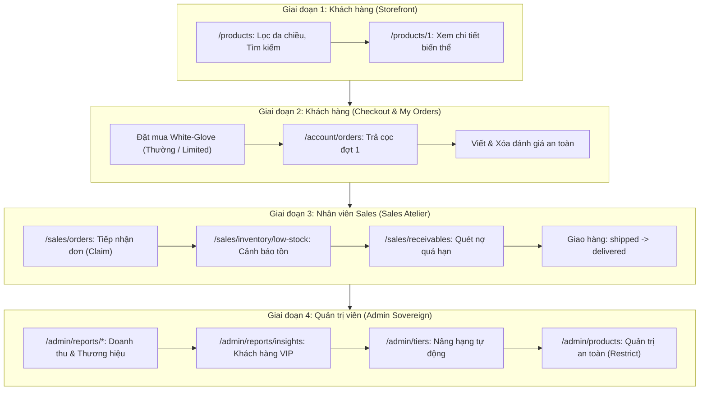

# Kịch Bản Demo Happy Path & Ma Trận 8 Loại Truy Vấn SQL (AUREN DBMS)

> **Môn học**: Hệ Quản Trị Cơ Sở Dữ Liệu (CO3021) — ĐHBK TP.HCM (HCMUT)  
> **Dự án**: AUREN Sovereign Architectural Furniture DBMS  
> **Mục tiêu tài liệu**: Hướng dẫn chi tiết luồng trình diễn (Happy Path) kéo dài 5–7 phút trước Hội đồng Giảng viên, bao phủ 100% 8 nhóm kỹ thuật truy vấn SQL (từ `a` đến `h`), kiểm soát giao dịch đồng thời (ACID Concurrency Control) và cơ chế khóa (Locking).

---

## 1. Sơ Đồ Tổng Quan Luồng Trình Diễn (Happy Path Flow)

Toàn bộ buổi demo được tổ chức theo vòng đời thực tế của đơn hàng White-Glove, chuyển giao liền mạch qua 3 vai trò người dùng trong hệ sinh thái AUREN:



---

## 2. Chuẩn Bị Trước Giờ Báo Cáo

### 2.1. Cấu hình Môi trường
- **Cửa sổ 1 (Trình duyệt SPA)**: Mở sẵn `http://localhost:5173/login`.
- **Cửa sổ 2 (Terminal Backend / MySQL Client)**: Mở sẵn cửa sổ chạy lệnh Node.js backend để giảng viên trực tiếp nhìn thấy các câu lệnh SQL thuần (Raw SQL) được in ra console theo thời gian thực khi thao tác trên giao diện.

### 2.2. Danh Sách Tài Khoản Demo
Các tài khoản mẫu đã được tích hợp sẵn widget **Nhấn để điền nhanh** tại màn hình Đăng nhập (`/login`):

| Vai trò | Email đăng nhập | Mật khẩu | Đặc điểm hiển thị |
| :--- | :--- | :---: | :--- |
| **Khách hàng (Customer)** | `customer.silver@gmail.com` | `password123` | Hạng Bạc (Silver Patron), chiết khấu 5% |
| **Nhân viên Sales** | `sales.nam@luxury.com` | `password123` | Phụ trách điều phối showroom & quản lý nợ |
| **Quản trị viên (Admin)** | `admin@luxury.com` | `password123` | Toàn quyền khai phá dữ liệu & cấu hình hệ thống |

---

## 3. Kịch Bản Demo Từng Bước & Lời Thoại Thuyết Minh

### GIAI ĐOẠN 1: KHÁM PHÁ CATALOG & LỌC TÁC PHẨM ĐA CHIỀU
> **Mục tiêu**: Thể hiện các câu truy vấn phức hợp kết hợp nối nhiều bảng, gom nhóm và lọc trên giá trị tổng hợp.

1. **Thao tác trên màn hình**:
   - Truy cập vào trang danh mục: `/products`.
   - Tại bộ lọc bên trái:
     - Chọn danh mục: **Sofa & Ghế bành** (hoặc gõ từ khóa `"Sofa"`).
     - Chọn chất liệu: **Da tự nhiên (Full-grain Leather)**.
     - Kéo khoảng giá: từ **50.000.000 ₫** đến **200.000.000 ₫**.
     - Chọn sắp xếp: **Giá tăng dần**.
   - Bấm vào một tác phẩm bất kỳ để vào trang chi tiết `/products/1`.

2. **Truy vấn SQL thực thi dưới CSDL**:
   - **Loại (d) — `SELECT` & Filter**: Tìm kiếm động với `LIKE`, `IN`, điều kiện khoảng giá `BETWEEN`, phân trang `LIMIT ? OFFSET ?`.
   - **Loại (f) — Multi-table `JOIN` (5 bảng)**:
     `products p` $\Join$ `brands b` $\Join$ `categories c` $\Join$ `product_variants pv` $\Join$ `reviews r`.
   - **Loại (h) — Aggregate + `GROUP BY` + `HAVING`**:
     - Hàm tổng hợp: `MIN(pv.price) AS minPrice`, `AVG(r.rating) AS avgRating`, `COUNT(DISTINCT r.id) AS reviewCount`.
     - Gom nhóm: `GROUP BY p.id, b.id, b.name, c.id, c.name`.
     - **Mệnh đề `HAVING`**: Lọc giá tối thiểu của sản phẩm sau khi đã gom nhóm các biến thể (`HAVING minPrice >= ? AND minPrice <= ?`).
   - **Loại (g) — `SUBQUERY` trong `WHERE`**:
     ```sql
     -- backend/src/repository/catalog.repository.ts (findAll)
     AND (p.category_id = ? OR p.category_id IN (SELECT id FROM categories WHERE parent_id = ?))
     AND p.id IN (
       SELECT DISTINCT pv2.product_id
       FROM product_variants pv2
       JOIN variant_materials vm ON pv2.id = vm.variant_id
       WHERE vm.material_id IN (?)
     )
     ```

3. **Gợi ý lời thuyết minh với Giảng viên**:
   > *"Dạ thưa Thầy/Cô, ở màn hình Catalog, hệ thống sử dụng Raw SQL thuần kết nối 5 bảng. Điểm nhấn DBMS ở đây là mệnh đề `HAVING minPrice >= ?` được tính toán trực tiếp trên giá trị tổng hợp `MIN()` của các biến thể sau gom nhóm, đồng thời sử dụng Subquery lồng `IN (SELECT DISTINCT ...)` để lọc chính xác quan hệ N:M giữa biến thể sản phẩm và chất liệu chế tác."*

---

### GIAI ĐOẠN 2: ĐẶT MUA TÁC PHẨM & KIỂM SOÁT GIAO DỊCH ĐỒNG THỜI
> **Mục tiêu**: Thể hiện tính toàn vẹn Transaction ACID, chèn dữ liệu JSON đa bảng, và 2 cơ chế khóa: **Optimistic Locking** (hàng thường) cùng **Pessimistic Locking** (bản giới hạn).

1. **Thao tác trên màn hình**:
   - Bấm **Đăng nhập** $\to$ Chọn thẻ điền nhanh **Khách hàng** (`customer.silver@gmail.com`).
   - Chọn tác phẩm nội thất $\to$ Bấm **Đặt hàng White-Glove** (hoặc vào `/limited/1` đặt mua bản giới hạn).
   - Điền địa chỉ dinh thự giao nhận $\to$ Bấm **Xác nhận đặt hàng**.
   - Chuyển sang màn hình Đơn hàng cá nhân `/account/orders` $\to$ Bấm **Thanh toán đợt cọc (Payment #1)**.
   - Thử gửi một Đánh giá tác phẩm $\to$ Bấm nút **Xóa đánh giá** để kiểm chứng thao tác xóa an toàn.

2. **Truy vấn SQL thực thi dưới CSDL**:
   - **Loại (a) — `INSERT` trong Transaction**:
     - Chèn đồng thời vào `orders`, `order_items` (lưu thuộc tính cấu hình `specifications` dạng cột **MySQL `JSON`**), và tự động phân rã 2 đợt thanh toán vào bảng `payments` (`order.repository.ts`).
   - **Loại (c) — `UPDATE` & Locking**:
     - **Optimistic Locking (Hàng thường)**: Kiểm soát tồn kho bằng cột `version` (`inventory.repository.ts`):
       ```sql
       UPDATE inventory 
       SET qty_reserved = qty_reserved + ?, version = version + 1 
       WHERE variant_id = ? AND location_id = ? AND version = ? AND (qty_on_hand - qty_reserved) >= ?;
       ```
     - **Pessimistic Locking (Bản Limited Edition)**: Khóa độc quyền bản đánh số serial nhỏ nhất bằng `FOR UPDATE` trong giao dịch `REPEATABLE READ` (`edition.repository.ts`):
       ```sql
       SELECT id, serial_no FROM edition_units 
       WHERE variant_id = ? AND status = 'available' 
       ORDER BY id ASC LIMIT 1 FOR UPDATE;
       ```
   - **Loại (b) — `DELETE`**:
     - Xóa đánh giá có đối soát khóa ngoại và chủ quyền (`DELETE FROM reviews WHERE id = ? AND customer_id = ?` tại `review.repository.ts`).
     - Cơ chế Safe Delete kiểm tra ràng buộc `RESTRICT` đối với danh mục/sản phẩm tại `catalog.repository.ts`.

3. **Gợi ý lời thuyết minh với Giảng viên**:
   > *"Dạ thưa Thầy/Cô, toàn bộ quy trình đặt hàng được bao bọc trong một Transaction duy nhất. Nhóm phân chia thành 2 bài toán đồng thời kinh điển: với hàng sản xuất thường, dùng Optimistic Locking kiểm tra cột version để tối đa hóa throughput; còn với bản khắc Limited Edition (ví dụ số 01/15), nhóm dùng Pessimistic Lock `SELECT ... FOR UPDATE` để đảm bảo tuyệt đối không bao giờ xảy ra tình trạng 2 khách hàng mua trùng một số serial."*

---

### GIAI ĐOẠN 3: NHÂN VIÊN SALES ĐIỀU PHỐI ĐƠN HÀNG, KHO & CÔNG NỢ
> **Mục tiêu**: Thể hiện truy vấn Derived Table (Subquery tại FROM), hàm thời gian thực `DATEDIFF` và câu lệnh `UPDATE ... JOIN` bảo mật cấp dòng.

1. **Thao tác trên màn hình**:
   - Bấm **Đăng xuất** từ phía khách hàng.
   - Đăng nhập thẻ **Nhân viên Sales** (`sales.nam@luxury.com`) $\to$ Hệ thống tự động chuyển vào `/sales`.
   - Vào tab **Hàng đợi đơn hàng** (`/sales/orders`) $\to$ Tìm đơn vừa đặt $\to$ Bấm **Tiếp nhận xử lý (Claim)**.
   - Vào tab **Cảnh báo & Nhập kho** (`/sales/inventory/low-stock`) $\to$ Xem danh sách biến thể có tổng tồn kho toàn hệ thống chạm ngưỡng cảnh báo.
   - Vào tab **Sổ nợ & Quá hạn** (`/sales/receivables`) $\to$ Bấm nút **Quét & Đánh dấu quá hạn**.
   - Vào chi tiết đơn hàng $\to$ Cập nhật trạng thái sang `shipped` rồi sang `delivered` (kích hoạt cộng dồn `total_spent` cho khách hàng).

2. **Truy vấn SQL thực thi dưới CSDL**:
   - **Loại (g) — `SUBQUERY` trong mệnh đề `FROM` (Derived Table)**:
     - Tính tổng tồn khả dụng trên toàn bộ các showroom thông qua bảng phụ `tot` (`inventory.repository.ts`):
       ```sql
       SELECT i.variant_id, v.sku, p.name, (i.qty_on_hand - i.qty_reserved) AS available, tot.total_available
       FROM inventory i
       JOIN product_variants v ON i.variant_id = v.id
       JOIN products p ON v.product_id = p.id
       JOIN (
         SELECT variant_id, SUM(qty_on_hand - qty_reserved) AS total_available
         FROM inventory
         GROUP BY variant_id
       ) tot ON i.variant_id = tot.variant_id
       WHERE tot.total_available < ?;
       ```
   - **Loại (e) — Date/Time Query (`DATEDIFF`, `CURDATE`)**:
     - Tính số ngày trễ hạn thanh toán theo thời gian thực (`payment.repository.ts`):
       ```sql
       GREATEST(0, DATEDIFF(CURDATE(), p.due_date)) AS overdueDays
       ```
   - **Loại (c) — `UPDATE ... JOIN` kiểm tra Row-Level Security**:
     - Đánh dấu quá hạn đồng loạt các khoản nợ trễ hạn của các đơn do chính Sales đó phụ trách:
       ```sql
       UPDATE payments p
       JOIN orders o ON p.order_id = o.id
       SET p.status = 'overdue'
       WHERE p.status = 'pending' AND p.due_date < CURDATE() AND o.sales_user_id = ?;
       ```

3. **Gợi ý lời thuyết minh với Giảng viên**:
   > *"Dạ thưa Thầy/Cô, tại phân hệ Sales, nhóm ứng dụng Derived Table Subquery ngay tại mệnh đề FROM để tính toán tổng tồn khả dụng toàn quốc trước khi lọc điều kiện cảnh báo. Đồng thời câu lệnh cập nhật công nợ sử dụng cú pháp `UPDATE JOIN` kết hợp kiểm soát Row-level Security `o.sales_user_id = ?` để đảm bảo nhân viên chỉ can thiệp vào đơn hàng của mình."*

---

### GIAI ĐOẠN 4: ADMIN KHAI PHÁ DỮ LIỆU & NÂNG HẠNG THÀNH VIÊN TỰ ĐỘNG
> **Mục tiêu**: Thể hiện báo cáo phân tích tổng hợp (OLAP), định dạng thời gian `DATE_FORMAT`, Scalar Subquery và câu lệnh cập nhật hàng loạt bằng **Correlated Subquery**.

1. **Thao tác trên màn hình**:
   - Bấm **Đăng xuất** từ cổng Sales.
   - Đăng nhập thẻ **Quản trị viên** (`admin@luxury.com`) $\to$ Hệ thống chuyển thẳng vào `/admin`.
   - Vào menu **Báo Cáo** $\to$ **Doanh thu theo tháng** (`/admin/reports/revenue`).
   - Vào menu **Báo Cáo** $\to$ **Doanh số Thương hiệu** (`/admin/reports/brands`).
   - Vào menu **Báo Cáo** $\to$ **Đánh giá & Khách VIP** (`/admin/reports/insights`).
   - Vào menu **Hạng thành viên** $\to$ **Cấu hình Hạng & Nâng hạng** (`/admin/tiers`) $\to$ Bấm nút **Quét & Nâng hạng Tự động** (chọn chế độ Chạy thực thi).

2. **Truy vấn SQL thực thi dưới CSDL**:
   - **Loại (e) — Date/Time Query kết hợp Loại (h) Aggregate**:
     - Gom nhóm doanh thu theo năm-tháng bằng `DATE_FORMAT` (`report.repository.ts`):
       ```sql
       SELECT DATE_FORMAT(o.order_date, '%Y-%m') AS month, COALESCE(SUM(o.total), 0) AS revenue, COUNT(o.id) AS orderCount
       FROM orders o
       WHERE o.status = 'delivered'
       GROUP BY DATE_FORMAT(o.order_date, '%Y-%m') ORDER BY month ASC;
       ```
   - **Loại (f) — Multi-table `JOIN` 5 bảng kết hợp Aggregate & `HAVING`**:
     - Phân tích doanh số theo thương hiệu: `brands` $\Join$ `products` $\Join$ `product_variants` $\Join$ `order_items` $\Join$ `orders` với `HAVING revenue >= ?`.
   - **Loại (g) — Scalar `SUBQUERY`**:
     - Lọc danh sách khách hàng VIP có tổng chi tiêu vượt mức chi tiêu trung bình toàn hệ thống:
       ```sql
       SELECT c.id, u.full_name, t.name AS tierName, c.total_spent
       FROM customers c
       JOIN users u ON c.user_id = u.id
       JOIN membership_tiers t ON c.tier_id = t.id
       WHERE c.total_spent > (SELECT AVG(total_spent) FROM customers WHERE total_spent > 0)
       ORDER BY c.total_spent DESC;
       ```
   - **Loại (g) — Correlated Subquery trong câu lệnh `UPDATE`**:
     - Nâng/hạ hạng tự động hàng loạt cho toàn bộ khách hàng trực tiếp trong MySQL Engine (`tier.repository.ts`):
       ```sql
       UPDATE customers c
       SET c.tier_id = (
         SELECT t2.id FROM membership_tiers t2 
         WHERE t2.min_spent <= c.total_spent 
         ORDER BY t2.min_spent DESC LIMIT 1
       )
       WHERE c.tier_id <> (
         SELECT t3.id FROM membership_tiers t3 
         WHERE t3.min_spent <= c.total_spent 
         ORDER BY t3.min_spent DESC LIMIT 1
       ) OR c.tier_id IS NULL;
       ```

3. **Gợi ý lời thuyết minh với Giảng viên**:
   > *"Dạ thưa Thầy/Cô, ở tính năng tự động nâng hạng VIP, thay vì kéo toàn bộ dữ liệu khách hàng lên Backend Node.js để duyệt vòng lặp, nhóm đã đẩy toàn bộ khối lượng tính toán xuống CSDL bằng câu lệnh `UPDATE` với Correlated Subquery. CSDL sẽ đối soát mức `total_spent` của từng dòng khách hàng với bảng tiêu chuẩn hạng thành viên để cập nhật nguyên tử."*

---

## 4. Ma Trận Đối Chiếu 8 Loại Truy Vấn SQL (Bảo Bối Trả Lời Phản Biện)

Bảng tổng hợp vị trí triển khai chính xác để mở mã nguồn khi Giảng viên chất vấn:

| Ký hiệu | Nhóm kỹ thuật SQL | Màn hình Demo | Tập tin Repository & Hàm triển khai | Đoạn mã / Cú pháp SQL trọng tâm |
| :---: | :--- | :---: | :--- | :--- |
| **Loại (a)** | **`INSERT`** đa bảng trong Transaction | Đặt hàng (`/cart`, `/limited/1`) | `backend/src/repository/order.repository.ts`<br/>`createOrder`, `createOrderItem` | `INSERT INTO orders ...`, `INSERT INTO order_items ...` (lưu cột `specifications` kiểu `JSON`) |
| **Loại (b)** | **`DELETE`** an toàn (Safe / Restrict) | Đơn hàng (`/account/orders`), Admin (`/admin/products`) | `backend/src/repository/review.repository.ts`<br/>`deleteReview`<br/>`backend/src/repository/catalog.repository.ts`<br/>`deleteProductSafe` | `DELETE FROM reviews WHERE id = ? AND customer_id = ?`<br/>`DELETE FROM products WHERE id = ? AND id NOT IN (...)` |
| **Loại (c)** | **`UPDATE` & Locking** (Optimistic & Pessimistic) | Đặt hàng & Đổi trạng thái đơn hàng | `backend/src/repository/inventory.repository.ts`<br/>`checkAndReserveStock`<br/>`backend/src/repository/edition.repository.ts`<br/>`lockAvailableUnit` | `UPDATE inventory ... WHERE version = ? ...`<br/>`SELECT ... FROM edition_units ... FOR UPDATE` |
| **Loại (d)** | **`SELECT` & Dynamic Filter** | Danh mục tác phẩm (`/products`) | `backend/src/repository/catalog.repository.ts`<br/>`findAll` | `SELECT ... WHERE pv.status = 'active' AND ... ORDER BY ... LIMIT ? OFFSET ?` |
| **Loại (e)** | **Date/Time Query** | Sổ nợ Sales (`/sales/receivables`), Báo cáo (`/admin/reports/revenue`) | `backend/src/repository/payment.repository.ts`<br/>`findReceivables`<br/>`backend/src/repository/report.repository.ts`<br/>`getMonthlyRevenueReport` | `DATEDIFF(CURDATE(), p.due_date)`<br/>`DATE_FORMAT(o.order_date, '%Y-%m')` |
| **Loại (f)** | **Multi-table `JOIN`** (3 - 5 bảng) | Chi tiết sản phẩm (`/products/1`), Báo cáo thương hiệu (`/admin/reports/brands`) | `backend/src/repository/report.repository.ts`<br/>`getBrandSalesReport`<br/>`backend/src/repository/catalog.repository.ts`<br/>`findProductDetailById` | `FROM brands b JOIN products p ... JOIN product_variants pv ... JOIN order_items oi ... JOIN orders o ...` |
| **Loại (g)** | **`SUBQUERY`** (WHERE, FROM, UPDATE) | Cảnh báo kho (`/sales/inventory/low-stock`), Khách VIP (`/admin/reports/insights`), Nâng hạng (`/admin/tiers`) | `backend/src/repository/inventory.repository.ts`<br/>`findInventoryList`<br/>`backend/src/repository/report.repository.ts`<br/>`getTopCustomersReport`<br/>`backend/src/repository/tier.repository.ts`<br/>`recalculateTiers` | 1. Derived Table: `JOIN (SELECT variant_id, SUM(...) FROM inventory GROUP BY ...) tot`<br/>2. Scalar Subquery: `WHERE total_spent > (SELECT AVG(...) ...)`<br/>3. Correlated Subquery: `UPDATE customers SET tier_id = (SELECT ... WHERE min_spent <= c.total_spent ...)` |
| **Loại (h)** | **Aggregate + `GROUP BY` + `HAVING`** | Lọc giá sản phẩm (`/products`), Báo cáo doanh số | `backend/src/repository/catalog.repository.ts`<br/>`findAll`<br/>`backend/src/repository/report.repository.ts`<br/>`getBrandSalesReport` | `GROUP BY p.id ... HAVING minPrice >= ? AND minPrice <= ?`<br/>`COALESCE(SUM(oi.quantity * oi.unit_price), 0)` |

---

## 5. Các Câu Hỏi Phản Biện DBMS Thường Gặp & Cách Trả Lời

### Câu hỏi 1: *"Tại sao nhóm em không dùng Prisma hay TypeORM mà lại viết Raw SQL?"*
> **Trả lời**: *"Dạ thưa Thầy/Cô, việc sử dụng Raw SQL thuần giúp nhóm em kiểm soát chặt chẽ kế hoạch thực thi (Execution Plan) của MySQL Query Optimizer. ORM thường tự động sinh ra các câu query lồng hoặc gặp vấn đề N+1 query khi truy xuất các mối quan hệ phức tạp 5 bảng. Với Raw SQL, nhóm có thể chủ động áp dụng các kỹ thuật nâng cao như `HAVING`, Derived Table, Correlated Subquery, và các cơ chế khóa `FOR UPDATE` hoặc Optimistic Locking chính xác theo nhu cầu."*

### Câu hỏi 2: *"Tại sao trường `specifications` trong bảng `order_items` lại lưu dưới dạng JSON?"*
> **Trả lời**: *"Dạ thưa Thầy/Cô, trong đồ án này, mỗi tác phẩm nội thất cao cấp có thể có những thông số đo đạc tùy biến độc nhất theo dinh thự của khách hàng (chiều cao tay vịn, tỷ lệ phối da, ghi chú hoàn thiện thủ công). Việc dùng cột kiểu `JSON` của MySQL cho phép lưu trữ bán cấu trúc linh hoạt mà không cần phải tạo thêm quá nhiều bảng phụ (EAV pattern) làm suy giảm hiệu năng JOIN."*

### Câu hỏi 3: *"Nhóm đã kiểm chứng hiệu năng chỉ mục (Index) như thế nào?"*
> **Trả lời**: *"Dạ thưa Thầy/Cô, trong file `database/indexes.sql`, nhóm em đã tách riêng các lệnh tạo Secondary B-Tree Composite Indexes. Nhóm đã viết script `npm --prefix backend run seed:large -- 30000` để bơm dữ liệu lớn (hơn 30.000 đơn hàng, 60.000 dòng hàng) và dùng lệnh `EXPLAIN ANALYZE` để đo lường. Khi chưa có index, phép quét là Table Scan (`type: ALL`) tốn hàng trăm mili-giây; sau khi tạo Composite Index `(status, order_date)`, chi phí truy vấn giảm xuống còn Index Range Scan chỉ trong vài mili-giây."*
