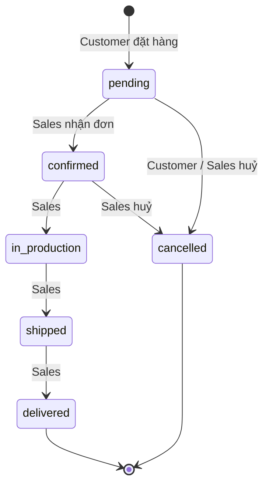

# ROLE_MATRIX - Ma trận phân quyền

Hệ thống có 4 vai trò. `Guest` là trạng thái chưa đăng nhập, ba vai trò còn lại khớp enum `user_role` (`customer`, `sales`, `admin`) trong ERD.

**Ký hiệu**

| Ký hiệu | Ý nghĩa                                      |
| ------- | -------------------------------------------- |
| ✅      | Được phép toàn bộ                            |
| 🔒      | Chỉ trên dữ liệu của chính mình (row-level)  |
| 🔶      | Có điều kiện (ghi chú ở cột cuối hoặc mục 4) |
| 👁      | Chỉ đọc                                      |
| ❌      | Không được phép                              |

---

## 1. Ma trận Role × Yêu cầu chức năng

| FR        | Chức năng                                   |   Guest    | Customer | Sales | Admin | Ghi chú                                                                                    |
| --------- | ------------------------------------------- | :--------: | :------: | :---: | :---: | ------------------------------------------------------------------------------------------ |
| FR0       | Đăng nhập / Đăng xuất                       | ✅ (login) |    ✅    |  ✅   |  ✅   | Ngoài 15 FR, không tính vào n                                                              |
| FR1       | Đăng ký tài khoản                           |     ✅     |    ❌    |  ❌   |  ❌   | Chỉ tạo role `customer`. Sales/Admin do Admin tạo                                          |
| FR2       | Xem DS sản phẩm theo danh mục / thương hiệu |     ✅     |    ✅    |  ✅   |  ✅   |                                                                                            |
| FR3       | Tìm kiếm, lọc nâng cao                      |     ✅     |    ✅    |  ✅   |  ✅   |                                                                                            |
| FR4       | Xem chi tiết sản phẩm                       |     ✅     |    ✅    |  ✅   |  ✅   | Tồn kho: Guest chỉ thấy "Còn hàng / Hết hàng", các role khác thấy số lượng theo kho        |
| FR5       | Đặt hàng                                    |     ❌     |    ✅    |  ❌   |  ❌   | Sales không đặt hộ trong phạm vi demo                                                      |
| FR6       | Mua Limited Edition                         |     ❌     |    ✅    |  ❌   |  ❌   |                                                                                            |
| FR7       | Thanh toán (trả khoản)                      |     ❌     |    🔒    |  ❌   |  ❌   | Customer trả các khoản của đơn mình                                                        |
| FR7b      | Tạo lịch thanh toán cho đơn                 |     ❌     |    ❌    |  🔒   |  ❌   | Sales tạo cho đơn mình phụ trách                                                           |
| FR8       | Lịch sử đơn và lịch thanh toán              |     ❌     |    🔒    |  🔒   |  👁   | Sales: đơn mình phụ trách. Admin: tất cả                                                   |
| FR9       | Huỷ đơn hàng                                |     ❌     |   🔒🔶   |  🔶   |  ❌   | Customer: đơn mình, trạng thái `pending`. Sales: đơn mình phụ trách, `pending`/`confirmed` |
| FR10      | Đánh giá sản phẩm đã mua                    |     ❌     |   🔒🔶   |  ❌   |  🔶   | Customer: tạo/xoá đánh giá của mình, đơn `delivered`. Admin: chỉ xoá (kiểm duyệt)          |
| FR11      | Xử lý đơn hàng                              |     ❌     |    ❌    |  🔶   |  ❌   | Nhận đơn `pending` chưa có người phụ trách, cập nhật tiến độ đơn của mình                  |
| FR12      | Quản lý tồn kho                             |     ❌     |    ❌    |  ✅   |  👁   | Sales nhập kho, xem cảnh báo sắp hết. Admin chỉ xem                                        |
| FR13      | Công nợ và thanh toán quá hạn               |     ❌     |    ❌    |  🔒   |  👁   | Sales: đơn mình phụ trách                                                                  |
| FR14      | Quản lý sản phẩm, biến thể, chất liệu       |     ❌     |    ❌    |  ❌   |  ✅   | CRUD                                                                                       |
| FR15a     | Báo cáo thống kê                            |     ❌     |    ❌    |  ❌   |  ✅   | Doanh thu, thương hiệu, đánh giá                                                           |
| FR15b     | Quản lý hạng thành viên                     |     ❌     |    ❌    |  ❌   |  ✅   | CRUD hạng, nâng hạng tự động                                                               |
| (bổ sung) | Quản lý người dùng                          |     ❌     |    ❌    |  ❌   |  ✅   | Tạo Sales/Admin, đổi role, khoá tài khoản                                                  |
| (bổ sung) | Xem hồ sơ và hạng thành viên của mình       |     ❌     |    🔒    |  🔒   |  🔒   |                                                                                            |

---

## 2. Ma trận Role × Bảng dữ liệu (CRUD)

C = Create, R = Read, U = Update, D = Delete. Dấu `*` nghĩa là bị giới hạn theo điều kiện ở mục 4.

| Bảng                | Guest              | Customer                   | Sales                    | Admin                            |
| ------------------- | ------------------ | -------------------------- | ------------------------ | -------------------------------- |
| `users`             | C (đăng ký)        | R*, U* (hồ sơ mình)        | R*, U* (hồ sơ mình)      | CRUD                             |
| `membership_tiers`  | R                  | R                          | R                        | CRUD                             |
| `customers`         | -                  | R*, U*                     | R\* (khách của đơn mình) | R, U (nâng hạng)                 |
| `brands`            | R                  | R                          | R                        | CRUD                             |
| `categories`        | R                  | R                          | R                        | CRUD                             |
| `products`          | R                  | R                          | R                        | CRUD                             |
| `materials`         | R                  | R                          | R                        | CRUD                             |
| `product_variants`  | R                  | R                          | R                        | CRUD\* (D chỉ khi chưa từng bán) |
| `variant_materials` | R                  | R                          | R                        | CRUD                             |
| `locations`         | R (tên showroom)   | R                          | R                        | CRUD                             |
| `inventory`         | - (chỉ cờ còn/hết) | R (khả dụng)               | R, U                     | R                                |
| `edition_units`     | -                  | R*, U* (qua giao dịch mua) | R                        | CRUD                             |
| `orders`            | -                  | C, R*, U* (huỷ)            | R*, U*                   | R                                |
| `order_items`       | -                  | C, R*, D* (khi huỷ)        | R\*                      | R                                |
| `payments`          | -                  | R*, U* (trả tiền)          | C*, R*, U\*              | R                                |
| `reviews`           | R                  | C, R, D\*                  | R                        | R, D                             |

Lưu ý: Customer và Sales không ghi trực tiếp lên `inventory` / `edition_units` bằng API riêng. Việc giữ hàng và giải phóng hàng luôn nằm trong cùng transaction với đặt/huỷ đơn.

---

## 3. Ma trận Role × Nhóm API

| Nhóm API (prefix)                                                         | Guest | Customer | Sales |    Admin    |
| ------------------------------------------------------------------------- | :---: | :------: | :---: | :---------: |
| `/api/auth/*`                                                             |  ✅   |    ✅    |  ✅   |     ✅      |
| `/api/products`, `/api/categories`, `/api/brands`, `/api/materials` (GET) |  ✅   |    ✅    |  ✅   |     ✅      |
| `/api/orders/*` (nhóm của khách)                                          |  ❌   |    ✅    |  ❌   |     ❌      |
| `/api/payments/*` (trả khoản)                                             |  ❌   |    ✅    |  ❌   |     ❌      |
| `/api/reviews/*`                                                          |  GET  |    ✅    |  GET  | ✅ (DELETE) |
| `/api/sales/*`                                                            |  ❌   |    ❌    |  ✅   |  👁 (GET)   |
| `/api/admin/*`                                                            |  ❌   |    ❌    |  ❌   |     ✅      |

Phân quyền được cài đặt bằng middleware `authenticate` (kiểm JWT) và `authorize(...roles)` (kiểm role). Xem `ARCHITECTURE.md`.

---

## 4. Quy tắc phân quyền theo dòng dữ liệu (row-level) và điều kiện nghiệp vụ

Các quy tắc này nằm ở tầng **service** và được ép bằng điều kiện `WHERE` trong tầng **repository**, không chỉ dựa vào UI.

| #   | Quy tắc                                                                                 | Thực thi                                                                   |
| --- | --------------------------------------------------------------------------------------- | -------------------------------------------------------------------------- |
| R1  | Customer chỉ đọc/huỷ/trả tiền cho đơn có `orders.customer_id` = customer của token      | `WHERE o.customer_id = ?`                                                  |
| R2  | Customer chỉ huỷ khi `orders.status = 'pending'`                                        | `UPDATE ... WHERE id = ? AND status = 'pending'`, kiểm `affectedRows`      |
| R3  | Customer chỉ đánh giá `order_item` thuộc đơn của mình và đơn đã `delivered`             | `INSERT ... SELECT ... WHERE o.customer_id = ? AND o.status = 'delivered'` |
| R4  | Mỗi `order_item` chỉ được đánh giá một lần                                              | UNIQUE `(customer_id, order_item_id)`                                      |
| R5  | Customer chỉ xoá review của mình                                                        | `DELETE ... WHERE id = ? AND customer_id = ?`                              |
| R6  | Sales chỉ nhận đơn `pending` chưa có `sales_user_id`                                    | `UPDATE ... WHERE id = ? AND status = 'pending' AND sales_user_id IS NULL` |
| R7  | Sales chỉ thao tác đơn có `sales_user_id` = mình                                        | `WHERE sales_user_id = ?`                                                  |
| R8  | Sales chỉ huỷ đơn `pending` hoặc `confirmed` của mình                                   | Kiểm trạng thái trong service                                              |
| R9  | Sales xem công nợ của đơn mình phụ trách                                                | `WHERE o.sales_user_id = ?`                                                |
| R10 | Admin không sửa trạng thái đơn, chỉ đọc, để giữ trách nhiệm cho Sales                   | Không có route ghi cho Admin                                               |
| R11 | Admin chỉ xoá biến thể chưa từng bán                                                    | `NOT EXISTS (SELECT 1 FROM order_items ...)`                               |
| R12 | Admin không tự hạ role hoặc khoá chính mình                                             | Kiểm trong service                                                         |
| R13 | Đăng ký công khai luôn tạo `role = 'customer'`, bỏ qua trường `role` do client gửi      | Service gán cứng                                                           |
| R14 | Giá trị `unit_price`, `discount`, `total` luôn do server tính, không tin dữ liệu client | Service tra giá từ `product_variants` và hạng khách                        |

---

## 5. Luồng chuyển trạng thái đơn hàng theo role

| Từ                     | Sang            | Role thực hiện | Điều kiện                                                         |
| ---------------------- | --------------- | -------------- | ----------------------------------------------------------------- |
| (mới)                  | `pending`       | Customer       | Đặt hàng thành công (FR5/FR6)                                     |
| `pending`              | `confirmed`     | Sales          | Nhận đơn, gán `sales_user_id` (R6)                                |
| `confirmed`            | `in_production` | Sales          | Đơn của mình, nhập `delivery_date` dự kiến                        |
| `in_production`        | `shipped`       | Sales          | Đơn của mình                                                      |
| `shipped`              | `delivered`     | Sales          | Đơn của mình. Cộng `customers.total_spent` trong cùng transaction |
| `pending`              | `cancelled`     | Customer       | Đơn của mình (R2)                                                 |
| `pending`, `confirmed` | `cancelled`     | Sales          | Đơn của mình (R8)                                                 |

Mọi chuyển trạng thái khác bị từ chối với HTTP 409.

---

## 6. Tài khoản mẫu cho demo

Dùng [tài khoản và hạng đã đối chiếu với seed](../README.md#6-tài-khoản-demo-theo-phân-quyền-rbac). Đăng nhập Sales Nam và Sales Hoa ở hai phiên để kiểm tra mỗi người chỉ xem được đơn đã phân công cho mình hoặc đơn chờ nhận.

## 7. Quản lý tài khoản và kiểm duyệt

- Admin xem và tạo tài khoản nội bộ tại `GET/POST /api/admin/users`. Customer đăng ký qua `POST /api/auth/register`.
- Admin khóa hoặc mở khóa Sales và Customer qua `PATCH /api/admin/users/:id/status`. API từ chối khóa tài khoản Admin.
- Tài khoản inactive không đăng nhập được và token của tài khoản đó bị từ chối trên API bảo vệ trong thời gian bị khóa.
- Admin xem toàn bộ đánh giá tại `GET /api/admin/reviews` và xóa qua `DELETE /api/reviews/:id`. Customer chỉ xóa đánh giá của mình và chỉ đọc đánh giá theo dòng đơn của mình.
