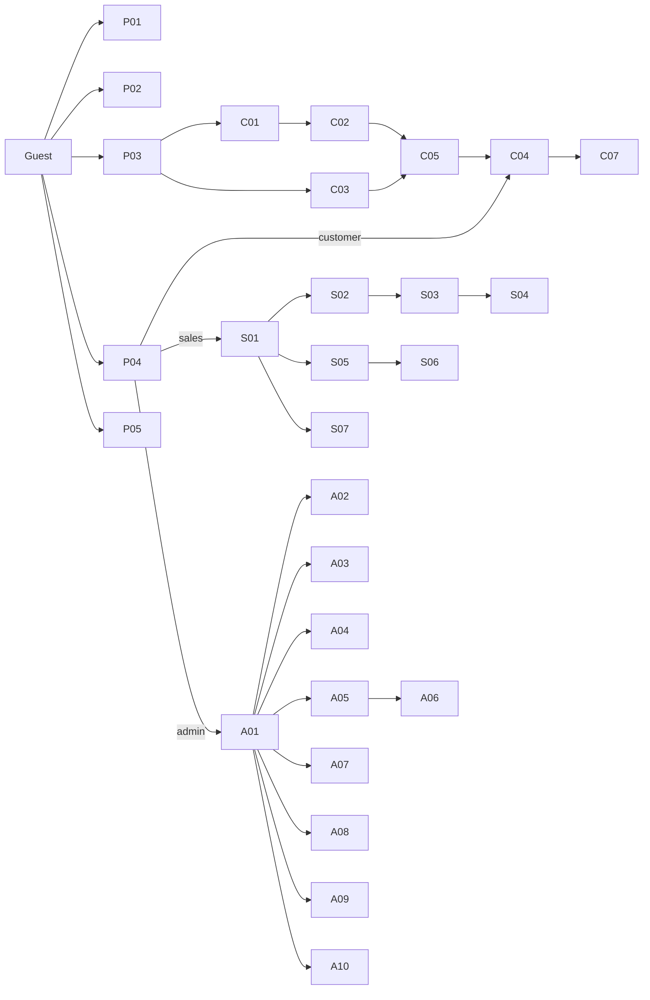

# SCREEN_INVENTORY - Danh sách màn hình

Frontend là React SPA (React Router). Tổng cộng **28 màn hình**: 5 công khai, 8 Customer, 7 Sales, 8 Admin. Ngoài ra có 2 trang hệ thống (403, 404).

**Quy ước**

- Route có tiền tố theo vai trò: `/` (công khai), `/account/*` (Customer), `/sales/*`, `/admin/*`.
- Giỏ hàng lưu ở client (React state + `localStorage`), ERD không có bảng giỏ hàng. Giá và tồn kho luôn được server kiểm tra lại khi đặt hàng.
- Cột **Query** ghi loại truy vấn (a-h theo đề): a Insert, b Delete, c Update, d điều kiện đơn, e điều kiện phức hợp, f Join, g Subquery, h Aggregate.

---

## 1. Màn hình công khai (Guest và dùng chung)

| ID  | Màn hình           | Route           | FR              | API                                                          | Query | Thành phần chính                                                                                                                                           |
| --- | ------------------ | --------------- | --------------- | ------------------------------------------------------------ | ----- | ---------------------------------------------------------------------------------------------------------------------------------------------------------- |
| P01 | Trang chủ          | `/`             | FR2             | `GET /api/products?featured=1`, `GET /api/categories`        | d     | Banner, cây danh mục, bộ sưu tập nổi bật, khu Limited Edition                                                                                              |
| P02 | Danh sách sản phẩm | `/products`     | FR2, FR3        | `GET /api/products`, `GET /api/brands`, `GET /api/materials` | d, e  | Sidebar bộ lọc (danh mục, thương hiệu, chất liệu, khoảng giá, limited), ô tìm kiếm, phân trang, sắp xếp                                                    |
| P03 | Chi tiết sản phẩm  | `/products/:id` | FR4, FR10 (xem) | `GET /api/products/:id`     | f, h  | Thư viện ảnh, chọn biến thể (size, finish), bảng chất liệu, tồn kho theo showroom, điểm trung bình, danh sách đánh giá, nút Thêm vào giỏ / Mua bản Limited |
| P04 | Đăng nhập          | `/login`        | FR0             | `POST /api/auth/login`                                       | d     | Form email, mật khẩu. Điều hướng theo role sau khi đăng nhập                                                                                               |
| P05 | Đăng ký            | `/register`     | FR1             | `POST /api/auth/register`                                    | a     | Form họ tên, email, mật khẩu, SĐT, địa chỉ, thành phố                                                                                                      |

Trang hệ thống: **403** (không đủ quyền), **404** (không tìm thấy).

---

## 2. Màn hình Customer (`/account/*`)

| ID  | Màn hình                       | Route                                      | FR             | API                                                             | Query   | Thành phần chính                                                                                                                                                |
| --- | ------------------------------ | ------------------------------------------ | -------------- | --------------------------------------------------------------- | ------- | --------------------------------------------------------------------------------------------------------------------------------------------------------------- |
| C01 | Giỏ hàng                       | `/cart`                                    | FR5            | (client), `GET /api/products/:id` để làm mới giá                | d       | Danh sách dòng hàng, đổi số lượng, chọn kho xuất, nhập yêu cầu tuỳ chỉnh (chất liệu, màu, kích thước)                                                           |
| C02 | Thanh toán / Xác nhận đặt hàng | `/checkout`                                | FR5, FR7       | `POST /api/orders`                                              | a, c    | Địa chỉ giao (snapshot), tóm tắt tạm tính, giảm giá theo hạng, tổng tiền, chọn phương án thanh toán (cọc, trả góp), thông báo lỗi hết hàng / xung đột phiên bản |
| C03 | Mua bản Limited Edition        | `/limited/:variantId`                      | FR6            | `GET /api/limited/:variantId/units`, `POST /api/orders` | d, c    | Số bản còn lại (vd. 12/50), serial được cấp, thông báo "vừa có người mua trước"                                                              |
| C04 | Đơn hàng của tôi               | `/account/orders`                          | FR8            | `GET /api/orders`                                            | f       | Bảng đơn (mã, ngày, trạng thái, tổng tiền), lọc theo trạng thái                                                                                                 |
| C04 | Chi tiết đơn hàng (modal)      | `/account/orders`                      | FR8, FR9, FR10 | `GET /api/orders/:id`, `POST /api/orders/:id/cancel`            | f, c, b | Timeline trạng thái, danh sách dòng hàng, lịch thanh toán, nút **Huỷ đơn** (chỉ khi `pending`), nút **Đánh giá** (chỉ khi `delivered`)                          |
| C04 | Thanh toán (trong modal)       | `/account/orders`                  | FR7            | `GET /api/orders/:id`, `POST /api/payments/:id/pay`    | c       | Danh sách khoản (cọc, trả góp, cuối) với hạn và trạng thái, chọn phương thức, xác nhận trả                                                                      |
| C05 | Xác nhận đặt hàng | `/checkout/success` | FR5, FR6 | Kết quả `POST /api/orders` | a | Mã đơn hàng và liên kết đến danh sách đơn |
| C07 | Viết đánh giá                  | `/account/orders/:id/items/:itemId/review` | FR10           | `POST /api/reviews`, `DELETE /api/reviews/:id`                  | a, b, g | Chấm sao 1-5, bình luận, nút xoá đánh giá của mình                                                                                                              |
| C08 | Hồ sơ và hạng thành viên       | `/account/profile`                         | (bổ sung)      | `GET /api/auth/me`, `PATCH /api/auth/me`                        | d, c    | Thông tin cá nhân, hạng hiện tại, tổng chi tiêu, thanh tiến độ lên hạng kế                                                                                      |

---

## 3. Màn hình Sales (`/sales/*`)

| ID  | Màn hình                     | Route                        | FR        | API                                                                                                    | Query   | Thành phần chính                                                                                  |
| --- | ---------------------------- | ---------------------------- | --------- | ------------------------------------------------------------------------------------------------------ | ------- | ------------------------------------------------------------------------------------------------- |
| S01 | Bảng điều khiển Sales        | `/sales`                     | FR11-13   | `GET /api/sales/summary`                                                                               | h       | Số đơn chờ nhận, đơn đang xử lý, biến thể sắp hết, tổng nợ quá hạn                                |
| S02 | Hàng đợi đơn hàng            | `/sales/orders`              | FR11      | `GET /api/sales/orders?status=`, `PATCH /api/sales/orders/:id/claim`                                   | d, c    | Tab "Chờ nhận" (chưa có người phụ trách) và "Của tôi", nút **Nhận đơn**                           |
| S03 | Xử lý đơn hàng               | `/sales/orders/:id`          | FR11, FR9 | `GET /api/sales/orders/:id`, `PATCH /api/sales/orders/:id/status`, `POST /api/sales/orders/:id/cancel` | f, c    | Thông tin khách, dòng hàng, nút chuyển trạng thái hợp lệ kế tiếp, nhập ngày giao dự kiến, huỷ đơn |
| S04 | Lịch thanh toán của đơn      | `/sales/orders/:id/payments` | FR7b      | `POST /api/sales/orders/:id/payments`, `GET /api/sales/orders/:id`                                  | a, f    | Form tạo cọc / trả góp / thanh toán cuối (số tiền, hạn), bảng khoản hiện có                       |
| S05 | Tồn kho                      | `/sales/inventory`           | FR12      | `GET /api/sales/inventory`, `GET /api/locations`                                                       | f       | Bảng biến thể × kho (tồn, đang giữ, khả dụng), lọc theo kho, nhập SKU tìm nhanh                   |
| S06 | Cảnh báo sắp hết và nhập kho | `/sales/inventory/low-stock` | FR12      | `GET /api/sales/inventory/low-stock`, `PATCH /api/sales/inventory/restock`                             | g, c    | Danh sách biến thể dưới ngưỡng, form nhập thêm số lượng, xử lý xung đột `version`                 |
| S07 | Công nợ và quá hạn           | `/sales/receivables`         | FR13      | `GET /api/sales/receivables`, `POST /api/sales/receivables/mark-overdue`                               | e, f, c | Bảng khoản quá hạn (khách, SĐT, đơn, số tiền, hạn), nút **Đánh dấu quá hạn**                      |

---

## 4. Màn hình Admin (`/admin/*`)

| ID  | Màn hình                           | Route                          | FR    | API                                                                                                | Query      | Thành phần chính                                                                                                       |
| --- | ---------------------------------- | ------------------------------ | ----- | -------------------------------------------------------------------------------------------------- | ---------- | ---------------------------------------------------------------------------------------------------------------------- |
| A01 | Dashboard báo cáo                  | `/admin`                       | FR15a | `GET /api/admin/reports/summary`                                                                   | h          | Thẻ KPI (doanh thu, số đơn, khách mới), biểu đồ doanh thu theo tháng                                                   |
| A02 | Báo cáo doanh thu                  | `/admin/reports/revenue`       | FR15a | `GET /api/admin/reports/revenue`                                                                   | h          | Doanh thu và số đơn theo tháng, xuất CSV                                                                               |
| A03 | Báo cáo thương hiệu / danh mục     | `/admin/reports/brands`        | FR15a | `GET /api/admin/reports/brand-sales?min=`                                                          | f, h       | Top thương hiệu theo doanh số, ngưỡng tối thiểu (HAVING)                                                               |
| A04 | Báo cáo đánh giá và khách VIP      | `/admin/reports/insights`      | FR15a | `GET /api/admin/reports/ratings`, `GET /api/admin/reports/top-customers`                           | h, g       | Điểm trung bình theo sản phẩm (HAVING n ≥ 3), khách chi tiêu trên mức trung bình                                       |
| A05 | Quản lý sản phẩm                   | `/admin/products`              | FR14  | `GET /api/products?includeInactive=true; POST /api/admin/products; PATCH/DELETE /api/admin/products/:id`                                                        | a, c, b, d | Bảng sản phẩm, tìm kiếm, nút thêm / sửa / xoá                                                                          |
| A06 | Biến thể và chất liệu của sản phẩm | `/admin/products/:id/variants` | FR14  | `/api/admin/products/:id/variants`, `/api/admin/variants/:id` | a, c, b, g | Bảng biến thể (SKU, size, finish, giá, lead time, trạng thái), gán chất liệu và tỉ lệ. Xoá bị chặn nếu biến thể đã bán |
| A07 | Danh mục, thương hiệu, chất liệu   | `/admin/catalog`               | FR14  | `/api/admin/categories`, `/api/admin/brands`, `/api/admin/materials`                               | a, c, b    | Tab con cho từng danh mục dữ liệu tham chiếu, cây danh mục tự tham chiếu                                               |
| A08 | Hạng thành viên                    | `/admin/tiers`                 | FR15b | `GET /api/admin/tiers; PATCH /api/admin/tiers/:id`, `POST /api/admin/tiers/recalculate`                             | a, c, g    | Bảng hạng (ngưỡng chi tiêu, % giảm), nút **Nâng hạng tự động** hiện số khách bị ảnh hưởng                              |

### Quản trị hệ thống

| ID  | Màn hình            | Route            | API                                           | Query   | Ghi chú                                   |
| --- | ------------------- | ---------------- | --------------------------------------------- | ------- | ----------------------------------------- |
| A09 | Quản lý người dùng  | `/admin/users`   | `GET/POST /api/admin/users; PATCH /api/admin/users/:id/status`             | a, c, d | Tìm, lọc, tạo Sales/Admin và khóa/mở khóa Sales hoặc Customer |
| A10 | Kiểm duyệt đánh giá | `/admin/reviews` | `GET /api/admin/reviews`, `DELETE /api/reviews/:id` | f, b    | Lọc theo số sao, tìm theo sản phẩm/khách và xóa đánh giá                      |

---

## 5. Bản đồ điều hướng theo role

## 6. Thành phần giao diện dùng chung

| Thành phần                                 | Dùng ở                    | Mô tả                                                     |
| ------------------------------------------ | ------------------------- | --------------------------------------------------------- |
| `AppLayout` (header, menu theo role)       | Tất cả                    | Menu thay đổi theo role trong token                       |
| `ProtectedRoute({ roles })`                | Customer, Sales, Admin    | Chưa đăng nhập chuyển `/login`, sai role chuyển 403       |
| `ProductCard`, `VariantPicker`, `PriceTag` | P01-P03, C01              | Định dạng tiền VND                                        |
| `StatusBadge`                              | C04, C05, S02, S03, S07   | Màu theo `order_status` và `payment_status`               |
| `DataTable` (phân trang, sắp xếp)          | Hầu hết màn hình quản trị |                                                           |
| `ConfirmDialog`, `Toast`                   | Mọi thao tác ghi          | Xác nhận huỷ, xoá. Thông báo lỗi 409 (xung đột, hết hàng) |
| `ChartCard` (Recharts)                     | A01-A04                   | Biểu đồ cột, đường                                        |

## 7. Ánh xạ FR → màn hình (kiểm tra phủ)

| FR   | Màn hình                  |
| ---- | ------------------------- |
| FR1  | P05                       |
| FR2  | P01, P02                  |
| FR3  | P02                       |
| FR4  | P03                       |
| FR5  | C01, C02                  |
| FR6  | C03                       |
| FR7  | C04 (trả trong modal), S04 (lập lịch) |
| FR8  | C04                  |
| FR9  | C04, S03                  |
| FR10 | C07, P03                  |
| FR11 | S02, S03                  |
| FR12 | S05, S06                  |
| FR13 | S07                       |
| FR14 | A05, A06, A07             |
| FR15 | A01-A04, A08              |
